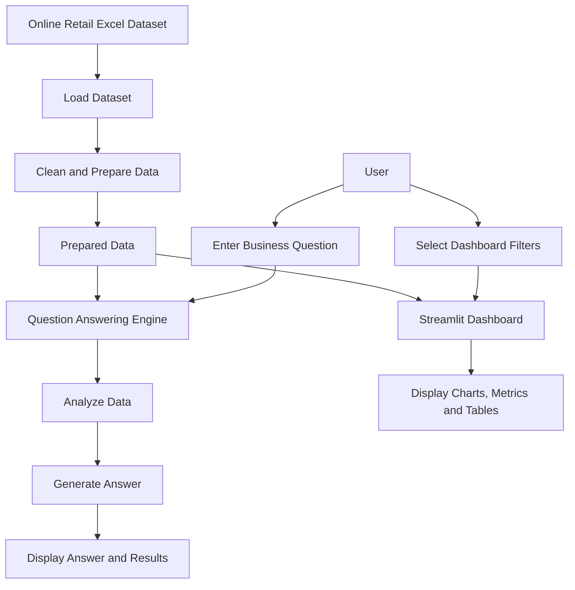

# Data Flow Diagram (DFD)

## AI-Powered Business Data Analyst

## Explanation

1. Dataset: Provides original retail transaction data.
2. Load Dataset: Reads the Excel file.
3. Clean and Prepare Data: Removes invalid records and prepares sales values.
4. Prepared Data: Stores cleaned information for analysis.
5. User Input: Accepts natural-language questions and dashboard filters.
6. Question Answering Engine: Processes the user's question.
7. Analyze Data: Performs the required calculations.
8. Results: Displays answers and supporting information.
