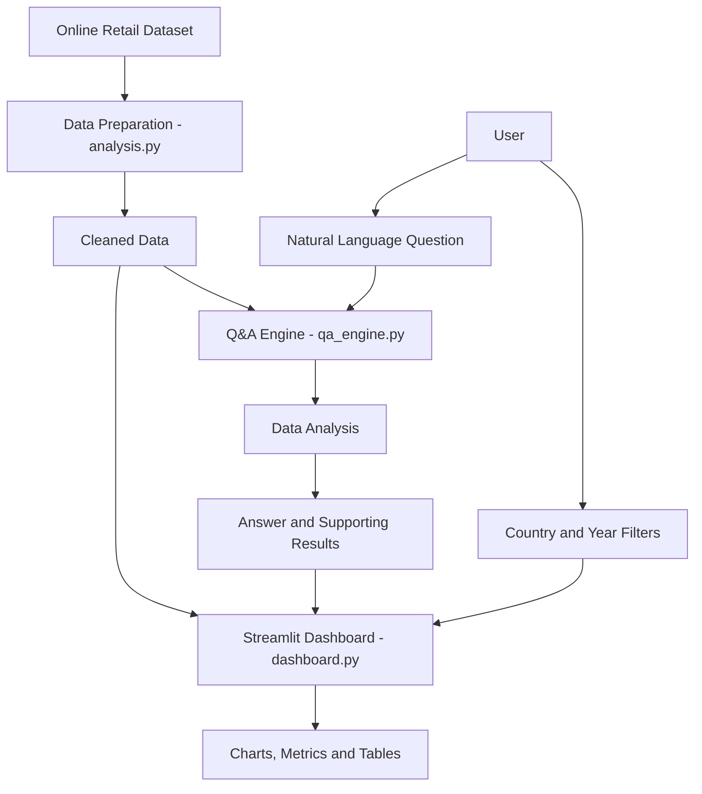

# System Architecture Diagram

## AI-Powered Business Data Analyst

## Explanation

1. Dataset: Uses the Online Retail Excel dataset.
2. Data Preparation: analysis.py loads and cleans the data.
3. Cleaned Data: Prepared data is used for analysis.
4. Dashboard: dashboard.py displays metrics, charts and filters.
5. Q&A Engine: qa_engine.py processes natural-language questions.
6. Data Analysis: Performs filtering, aggregation, comparison and ranking.
7. Results: Displays answers and supporting results.
